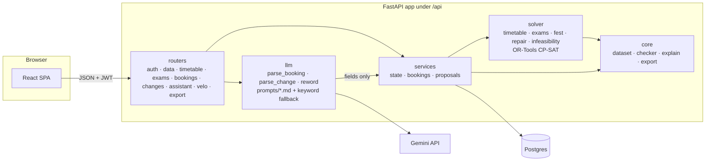

<div align="center">

# 🗓️ Velora

### Crunch Week — Chilika Institute of Technology

**Timetable generation · Midsem exam scheduling · Spectra-week venue booking · Disruption handling**


> 🚧 **Work in progress** — The engine, the API and the web frontend are built; deployment is next.  
> Live link and screenshots will be added here.

</div>

---

## 📑 Table of Contents

- [How It Works](#-how-it-works)
- [Tech Stack](#-tech-stack)
- [Getting Started](#-getting-started)
- [Deploy to Vercel](#-deploy-to-vercel)
- [Accounts](#-accounts)
- [API Overview](#-api-overview)
- [Rules Worth Knowing](#-rules-worth-knowing)
- [Known Limitations](#-known-limitations)
- [Repo Layout](#-repo-layout)
- [Running the Validator](#-running-the-validator)

---

## ⚙️ How It Works

> **The LLM talks, the solver decides, and every decision has a reason you can check.**



### Key Design Principles

| Principle | Details |
|-----------|---------|
| **Checker is the single source of truth** | `core/checker.py` mirrors `starter_pack/validator.py` rule-for-rule (tests compare the two). Solver output, manual moves, AI drafts, and approvals all pass through it before anything is saved. |
| **LLM is a helper, not the authority** | The LLM only fills in forms and rewords reasons — its output has no status or approval field. If it's down, slow, or returns junk, the assistant falls back to keyword rules and manual forms work unchanged. |
| **Proposals, not surprises** | Disruptions (change files, faculty leave, requests) become **proposals**. The repair solver moves as few sessions as possible and shows the diff. Nothing changes until the Admin approves, and approval re-checks against the timetable active at that moment. |

---

## 🧰 Tech Stack

| Layer | Technologies |
|-------|-------------|
| **Backend** | Python 3.12+ · FastAPI · SQLAlchemy 2 · Pydantic 2 |
| **Solver** | Google OR-Tools CP-SAT |
| **Database** | Postgres (Neon) — or SQLite locally |
| **Auth** | PyJWT + bcrypt |
| **AI Assistant** | Gemini 3.5 Flash-Lite *(optional)* |
| **Frontend** | React 19 + Vite + TypeScript + Tailwind 4 · shadcn/ui-style components on Radix · TanStack Query · Motion |

> 📄 Full list with licences → [THIRD_PARTY.md](THIRD_PARTY.md)  
> 🎨 The visual design and its research → [frontend/DESIGN.md](frontend/DESIGN.md)

---

## 🚀 Getting Started

### Prerequisites

- **Python 3.12+**
- **Node 20+** for the web frontend
- *(Optional)* A Postgres database URL or a `GEMINI_API_KEY`

### 1. Clone & set up the environment

```bash
# Create a virtual environment
python -m venv .venv

# Install dependencies
.venv/bin/pip install -r requirements-dev.txt        # Windows: .venv\Scripts\pip
```

### 2. Configure (optional)

```bash
cp .env.example .env       # every variable has a sensible local default
```

### 3. Start the server

```bash
.venv/bin/python -m uvicorn backend.app.main:app --port 8000
```

> 🌐 Open **http://localhost:8000/api/docs** for the interactive Swagger UI.  
> Without a `DATABASE_URL`, the app uses a local SQLite file (`local.db`) and seeds demo data on first start.

### 4. Start the web app

In a second terminal:

```bash
cd frontend
npm ci
npm run dev          # http://localhost:5173, proxies /api to :8000
```

> 🔐 Create an account, or use a demo tile under "Demo for judges".  
> To proxy to another API port, put `API_PROXY=http://localhost:8100` in `frontend/.env.local`. If the deployed `DEMO_PASSWORD` isn't `demo1234`, build with `VITE_DEMO_PASSWORD` set so the one-click buttons work.

### 5. Run the tests

```bash
# API tests (~3 min)
.venv/bin/python -m pytest backend/tests/api -q

# Engine tests (~7 min)
.venv/bin/python -m pytest backend/tests/engine -q -m "not slow"

# Frontend unit tests, type check, production build
cd frontend && npm test && npm run build
```

### 6. Export & validate

Produce the two export files from a running app (local or deployed) and check them with the official validator:

```bash
.venv/bin/python scripts/make_exports.py --base-url http://localhost:8000
```

### 7. Evaluate the AI assistant

Score the booking/change assistant on tricky requests (uses Gemini if `GEMINI_API_KEY` is set, otherwise the keyword fallback):

```bash
.venv/bin/python scripts/eval_llm.py
```

### Deploying to a PaaS

On Railway, Render, or Fly, the included `Procfile` starts the API with:

```
uvicorn backend.app.main:app --host 0.0.0.0 --port $PORT
```

---

## 🚢 Deploy to Vercel

`vercel.json` runs the API as one Python function (`api/index.py`, up to 300 s per request) under `/api`. The frontend still has to be added to it: a static build of `frontend/` (`npm ci && npm run build`, output `frontend/dist`), with every path outside `/api` falling back to `index.html` so deep links like `/timetable?view=room&id=AUD` work on reload.

1. **Create the project.** Either import the GitHub repo at vercel.com (Add New → Project; framework preset "Other"; leave the build settings alone), or deploy from a laptop with the CLI: `npm i -g vercel`, `vercel login`, `vercel link`.
2. **Add a database.** In the project's Storage tab, connect Neon (Postgres). It sets `DATABASE_URL`. Without it the app still starts, on a throwaway SQLite file, and `/api/health` says so. That's fine for a first check, not for judges.
3. **Set the environment variables** (Settings → Environment Variables, or `vercel env add NAME`):
   - `JWT_SECRET`: required. A deployed app refuses to start without 32+ random characters. Generate one with `python -c "import secrets; print(secrets.token_urlsafe(48))"`.
   - `DEMO_PASSWORD`: the password for every demo account. List it in the Demo accounts table below.
   - `GEMINI_API_KEY`: optional. Without it the assistant uses keyword rules.
   - `SOLVER_TIME_LIMIT_S` (default 60) and `SOLVER_WORKERS` (default 8). Lower the workers if the function has few CPUs.
4. **Deploy** (the Deploy button, or `vercel deploy --prod`). Then open `https://<project>.vercel.app/api/health`: `ok` should be true, `db` should be `ok` (not "temporary"), and `llm` should be `configured`. `/api/docs` has an Authorize button: paste the token from `POST /api/auth/login`.
5. **Measure the solver on Vercel's CPUs**, from any machine with this repo:
   ```bash
   python scripts/make_exports.py --base-url https://<project>.vercel.app --password <DEMO_PASSWORD> --out /tmp/vercel-check
   ```
   It prints the solve time and soft penalty, then runs the official validator on both files. A soft penalty well above 3, or a timeout, means too little CPU: raise `SOLVER_TIME_LIMIT_S` (at most about 280) or move the backend.

If the deploy fails on function size, or the solver is too slow, move the backend to Railway or Render (the `Procfile` covers it). Keep the frontend on Vercel, and change the `/api/(.*)` rewrite in `vercel.json` to `https://<backend-host>/api/$1`.

---

## 👥 Accounts

### Your own account

Anyone can **sign up** on the login page (*Create account*) with an email and a password of at least 8 characters, as a **club representative** or a **faculty member**. Faculty pick which faculty member they are, and each faculty member can have one own account. You're logged in straight away; the key button next to your name changes your password.

Coordinator and Admin are the roles that approve requests, so nobody can sign up as one. An Admin gives those roles under **Settings → People**, which lists every account; a change applies from the person's next click.

### Demo accounts (for judges)

All demo accounts use the password in `DEMO_PASSWORD` (default: **`demo1234`** locally). It's shared, so the app won't change it.  
The Admin's **"Reset Demo Data"** (`POST /api/admin/reset`) restores the starter dataset and removes every timetable, request, and proposal, people's own included. Every account stays.

The login page's **Demo for judges** section has one tile per role. Coordinator, Faculty and Club each have a dropdown, since the accounts come from the loaded dataset: one coordinator per department, one account per faculty member, one per club that makes venue requests.

| Role | Accounts (examples) | What to try |
|------|---------------------|-------------|
| 🔑 **Admin** (Dean's office) | `admin@cit.demo` | Generate timetable & exams, decide Spectra week, upload change files, approve proposals, export, reset |
| 🏫 **Dept. Coordinator** | `cse.coord@cit.demo`, `ece.coord@cit.demo`, … (8 departments: `<dept>.coord@cit.demo`) | Book rooms for department events, approve your department's lab bookings, move your department's sessions. Two coordinators show that nobody approves their own request |
| 👨‍🏫 **Faculty** | `f01@cit.demo` … `f40@cit.demo` (faculty id) | Own timetable, mark unavailability, ask the assistant to move a class |
| 🎭 **Club Rep** | `robotics-club@cit.demo`, `dramatics-society@cit.demo`, … (11 clubs) | Submit venue requests by typing or speaking, in English or Hinglish; cancel them; see status & reason |

---

## 🔌 API Overview

All routes live under `/api` and require `Authorization: Bearer <token>` except login, sign-up (and its faculty list), the demo-account list, and health.  
Errors always return: `{"error": {"code", "message", "details"}}`.

<details>
<summary><strong>📋 Click to expand full route table</strong></summary>

| Area | Routes |
|------|--------|
| **Auth** | `POST /auth/login` · `POST /auth/signup` · `GET /auth/signup-options` · `GET /me` · `POST /auth/password` · `GET /auth/demo-accounts` · `GET /users` *(Admin)* · `PUT /users/{id}` *(Admin: give a role)* |
| **Data** | `POST /data/dataset` *(Admin; JSON file)* · `GET /data/summary` · `GET/PUT /settings` *(priority order, lab owners)* · `POST /admin/reset` |
| **Timetable** | `POST /timetable/generate` · `GET /timetable?view=group\|faculty\|room\|all&id=&week=regular\|spectra` · `POST /timetable/check-move` · `POST /timetable/manual` · `GET /explain/session/{id}` |
| **Views** | `GET /dashboard` · `GET /rooms/free?day&from&to&capacity&needs&types&week` |
| **Exams** | `POST /exams/generate` · `GET /exams` |
| **Spectra Week** | `POST /bookings/check` · `POST /bookings` · `GET /bookings?mine=1` · `POST /bookings/{id}/cancel` · `POST /bookings/{id}/decide` · `POST /fest/decide-all` · `GET /fest` · `GET /explain/booking/{id}` |
| **Changes** | `POST /changes/file` · `POST /changes` · `POST /faculty/unavailability` · `GET /changes` · `GET /changes/{id}` · `POST /changes/{id}/approve` · `POST /changes/{id}/reject` |
| **Assistant** | `POST /assistant/booking` · `POST /assistant/change` · `POST /velo` (Velo, read-only) |
| **Export** | `GET /export/schedule.json?after=0\|1` |
| **Health** | `GET /health?deep=1` |

</details>

---

## 📏 Rules Worth Knowing

### Priority Order

> **Exams > Classes > Institute Events > Guest Lectures > Department Events > Club Events**

Ties go to the earlier submission. A role can't claim more than its cap (e.g. a club asking for "institute event" is treated as a club event, and the reason says so). The Admin can reorder the list in settings.

### Approval Flow

- **Code decides every booking** — a booking of a department's lab waits for that coordinator; if the coordinator made it, it waits for the Admin.
- **Timetable changes** wait for the Admin.
- **Nobody approves their own request.**
- The Admin's own change files and manual moves are shown as proposals — the Admin applies them after reviewing the diff.

### App Bookings & Classes

App bookings **never** move classes. Only the dataset's approved institute events may displace a class, and then only for Week 7 (`session_overrides`).

---

## ⚠️ Known Limitations

| Limitation | Details |
|-----------|---------|
| **Auth** | No email check and no "forgot password" email (there's no mail service), and no login rate limit. Own and demo accounts share one campus, so "Reset Demo Data" also clears requests made from own accounts. |
| **Long solves** | Solves run inside the request (no job queue); the solver time limit is set by `SOLVER_TIME_LIMIT_S`. |
| **CPU-dependent quality** | Solution quality depends on CPU cores. With one core the timetable is valid but less optimised in the same time. |
| **AI fallback** | Without `GEMINI_API_KEY`, the assistant uses keyword rules — fine for plain requests, weaker on vague or conditional ones. |

---

## 📁 Repo Layout

```
📦 crunchweek-cit-scheduler
├── 🔧 backend/
│   ├── app/
│   │   ├── core/          # Dataset loading, checker (mirrors validator), explanations, export
│   │   ├── solver/        # CP-SAT timetable, exams, Spectra-week, repair, infeasibility
│   │   ├── services/      # State, accounts, bookings, proposals — what the routers call
│   │   ├── routers/       # HTTP endpoints
│   │   └── llm/           # Gemini client, prompts/, parsers with keyword fallback
│   └── tests/
│       ├── engine/        # Solver + checker vs validator
│       └── api/           # HTTP flow tests
├── 🌐 api/
│   └── index.py           # Vercel function entry; vercel.json routes /api/* to it
├── 🎨 frontend/           # React SPA: src/pages (one per screen), src/components (board, timetable,
│                          #   booking, changes, ui), src/api (typed client); DESIGN.md is the design system
├── 📜 scripts/
│   └── make_exports.py    # Drives the app's API to produce exports/
├── 📦 starter_pack/       # Organisers' starter pack: dataset, validator, examples (never edited)
├── 📤 exports/            # schedule.json and schedule_after.json produced by the app
└── 📖 docs/               # DESIGN.md (product + system design), PLAN.md (build plan)
```

---

## ✅ Running the Validator

Validate the generated schedules against the official starter-pack validator:

```bash
# Validate the base schedule
python starter_pack/validator.py \
  --data starter_pack/data/cit_public.json \
  --schedule exports/schedule.json

# Validate the post-disruption schedule
python starter_pack/validator.py \
  --data starter_pack/data/cit_public.json \
  --schedule exports/schedule_after.json \
  --disruption starter_pack/examples/sample_disruption.json \
  --baseline exports/schedule.json
```

---

<div align="center">

**Built for the CIT Crunch Week Hackathon** 🏗️

</div>
