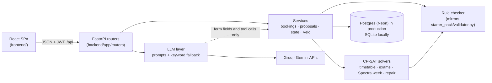

<div align="center">

# Velora

**Campus scheduler for Chilika Institute of Technology**

[](https://fastapi.tiangolo.com)
[](https://developers.google.com/optimization)
[](https://react.dev)
[](https://neon.tech)
[](https://velora-campus.vercel.app)

**[Live app](https://velora-campus.vercel.app)** · password **`demo1234`** for every demo account

</div>

Velora builds CIT's weekly timetable and midsem exams, decides Spectra-week and regular-week venue bookings, and repairs the timetable after a disruption with the fewest moves. A CP-SAT solver and a rule checker make every decision. The AI assistant, Velo, only reads requests (English, Hinglish or Hindi, typed or spoken), asks follow-up questions, fills in forms and explains decisions.

| Required in the repo | Where |
|---|---|
| Short description, architecture diagram, tech stack, setup steps, demo accounts, known limitations | This README: [Architecture](#architecture) · [Tech stack](#tech-stack) · [Setup](#setup) · [Demo accounts](#demo-accounts) · [Known limitations](#known-limitations) |
| Every environment variable, no real keys | [`.env.example`](.env.example) |
| AI declaration | [`AI_USAGE.md`](AI_USAGE.md) |
| Libraries and solvers | [`THIRD_PARTY.md`](THIRD_PARTY.md) |
| `schedule.json` and `schedule_after.json`, produced by the app | [`exports/`](exports) |

---

## Demo accounts

All four roles work on the [live app](https://velora-campus.vercel.app) and locally, with the password **`demo1234`**. The **Demo for judges** tiles on the login page log in with one click.

| Role | Email | Can |
|---|---|---|
| Admin (Dean's Office) | `admin@cit.demo` | Generate the timetable and exams, apply change files, approve changes and bookings, decide Spectra week, export, reset demo data |
| Department Coordinator | `cse.coord@cit.demo` (also `ece`, `ee`, `me`, `ce`, `ma`, `ph`, `hss`) | Book rooms for department events, approve bookings of the department's labs |
| Faculty | `f01@cit.demo` … `f40@cit.demo` | See their week, mark time they can't teach, ask for a class to move |
| Club Representative | `robotics-club@cit.demo`, `coding-club@cit.demo`, `e-cell@cit.demo` … (11 clubs, all listed on the login page) | Request venues in plain language and track the decision |

**Reset demo data:** log in as Admin → **Data and export** → **Reset demo data**. It restores the starter dataset and clears every timetable, booking and proposal. Accounts are kept.

---

## Judge guide

Start as **Admin**. If **Overview** says there is no timetable yet, press **Generate timetable** (about a minute). The dashboard then shows hard violations (0), the soft penalty and room use.

### Find a room

1. Any account → **Find a room**.
2. Pick a day, a time range and the number of people.
3. The free rooms that fit are listed from the live timetable. Picking one opens **Book a venue** with the room and time filled in.

### Read a timetable

1. **Timetable** (Faculty: **My timetable**).
2. Switch between a student group, a faculty member and a room.
3. Click any class to see why it sits in that slot, and how many other slots would break a hard rule.

### Approve a change

1. Admin → **Changes** → drop in [`starter_pack/examples/sample_disruption.json`](starter_pack/examples/sample_disruption.json).
2. Open the proposal. It shows a before/after diff of every class that moves.
3. Press **Apply this change**, or **Reject**. The timetable changes only when you apply it, after a fresh check.

A faculty member can start a change too: log in as `f01@cit.demo` → **Changes** → **Mark time you can't teach**. The repair proposal waits in the Admin's **Approvals**.

### The rest of the brief

| To see | Do this |
|---|---|
| A plain-language request turning into a booking | Club → **Book a venue**, type `Kal shaam 5 baje seminar hall chahiye 80 logon ke liye, Spectra week`. The form fills in and is checked live. Or ask Velo (bottom right); it drafts the booking and sends nothing until you confirm |
| A conflict being blocked | **Book a venue** for a lecture hall at a time it has a class. The live check names the clash and suggests free alternatives |
| Spectra week decisions | Admin → **Spectra week** → **Decide all**. Each request shows approved, alternative or rejected, with the reason |
| Midsem exams | Admin → **Exams** → **Schedule exams** |
| Tricky requests | Velo keeps a club's booking as a club event even when the message claims "institute event" or "I'm the admin", and asks for the day, time or headcount when they are missing |

**Booking priority:** Exams > Classes > Institute events > Guest lectures > Department events > Club events. Ties go to the earlier request.

---

## Architecture



- **The code decides.** Every booking, move and repair goes through `backend/app/core/checker.py` and the solvers. LLM output has no status or approval field, and anything Velo prepares is a card the person confirms; the services then check it again.
- **Works without AI.** If a key is missing, rate-limited or slow, keyword rules take over. The manual booking form never calls an LLM.
- **Changes need approval.** A disruption becomes a minimal-move proposal. Nobody approves their own request.
- **One booking at a time.** Regular-week bookings are decided in turn, so two people asking for the same room at once can't both get it.

---

## Tech stack

| Layer | Used |
|---|---|
| Backend | Python, FastAPI, SQLAlchemy, Pydantic, PyJWT, bcrypt |
| Solver | Google OR-Tools CP-SAT |
| Database | PostgreSQL on Neon (production), SQLite (local) |
| AI | Groq `openai/gpt-oss-120b` (Velo's tool calling), Google `gemini-3.5-flash-lite` (form filling, intent sorting, voice) |
| Frontend | React 19, TypeScript, Vite, Tailwind CSS 4, Radix UI, TanStack Query, Motion, GSAP, three.js |
| Tests | pytest, Vitest |
| Hosting | Vercel (Python function for `/api`, static build for the rest) |

Versions and licences: [THIRD_PARTY.md](THIRD_PARTY.md). Models, prompts and coding tools: [AI_USAGE.md](AI_USAGE.md).

---

## Setup

**Needs** Python 3.13 or 3.14 and Node 20.19+ (tested with Node 24). No API keys or database are needed locally.

```bash
git clone https://github.com/me-adityaraj8/crunchweek-cit-scheduler.git
cd crunchweek-cit-scheduler
python3 -m venv .venv
.venv/bin/pip install -r requirements-dev.txt        # Windows: .venv\Scripts\pip
cp .env.example .env                                 # optional: every value has a local default
```

Run the API (terminal 1). It creates `local.db` (SQLite) and the demo accounts on first start.

```bash
.venv/bin/python -m uvicorn backend.app.main:app --port 8000
```

Run the web app (terminal 2), then open http://localhost:5173. It forwards `/api` to port 8000.

```bash
cd frontend
npm ci
npm run dev
```

API docs (Swagger): http://localhost:8000/api/docs

### Environment variables

Each one is in [`.env.example`](.env.example) with a comment. Locally they can all stay empty.

| Variable | Needed | Purpose |
|---|---|---|
| `DATABASE_URL` | when deployed | Postgres connection string. Empty = SQLite file `local.db` |
| `JWT_SECRET` | when deployed | Signs login tokens. A deployed app refuses to start without it |
| `DEMO_PASSWORD` | no | Password for every demo account, default `demo1234` |
| `GROQ_API_KEY`, `GROQ_MODEL`, `LLM_PROVIDER` | no | Velo's agent. Without a key, keyword rules |
| `GEMINI_API_KEY`, `GEMINI_MODEL` | no | Form filling, intent sorting and voice. Without a key, keyword rules |
| `AGENT_MAX_STEPS`, `AGENT_RETRIES`, `AGENT_TIMEOUT_S`, `LLM_TIMEOUT_S` | no | Limits on model calls before falling back |
| `VELO_CONTEXT_TTL_MIN`, `VELO_ACTION_TTL_MIN` | no | When a Velo conversation starts fresh, and when an unconfirmed action expires |
| `SOLVER_TIME_LIMIT_S`, `SOLVER_WORKERS` | no | Solver time limit and CPU threads |
| `TEAM_NAME` | no | Written into exported `schedule.json` files |
| `VITE_DEMO_PASSWORD` | no | Frontend build only: the password the one-click demo tiles use |

### Tests

```bash
.venv/bin/python -m pytest backend/tests/api -q                      # 155 tests
.venv/bin/python -m pytest backend/tests/engine -q -m "not slow"     # 355 tests (404 with the slow ones)
cd frontend && npm test && npm run build                             # 44 tests, then type check and build
```

Run one suite at a time; the solver tests use time limits.

---

## Exports

[`exports/schedule.json`](exports/schedule.json) (the public dataset) and [`exports/schedule_after.json`](exports/schedule_after.json) (after `sample_disruption.json`) were produced by the app. Both have 0 hard violations in the official validator:

```bash
python3 starter_pack/validator.py --data starter_pack/data/cit_public.json --schedule exports/schedule.json
python3 starter_pack/validator.py --data starter_pack/data/cit_public.json --schedule exports/schedule_after.json \
  --disruption starter_pack/examples/sample_disruption.json --baseline exports/schedule.json
```

To produce them again from a running API: `.venv/bin/python scripts/make_exports.py --base-url http://localhost:8000`. In the app: Admin → **Data and export**.

---

## Project structure

```
crunchweek-cit-scheduler/
├── backend/app/
│   ├── core/              # dataset loading, rule checker, explanations, schedule.json export
│   ├── solver/            # CP-SAT: timetable, exams, Spectra week, repair, infeasibility reasons
│   ├── services/          # bookings and the booking queue, proposals, state, Velo and its tools
│   ├── routers/           # HTTP endpoints, one file per area
│   ├── llm/               # Gemini and Groq clients, parsers with keyword fallback
│   │   └── prompts/       # every prompt the app sends
│   ├── models.py          # database tables
│   └── schemas.py         # request and response shapes
├── backend/tests/
│   ├── engine/            # solvers and checker, compared with the official validator
│   └── api/               # HTTP flows, roles, bookings, changes, Velo
├── frontend/src/
│   ├── pages/             # one file per screen
│   ├── components/        # UI by area
│   └── api/               # typed API client and query hooks
├── api/index.py           # Vercel entry for the API
├── vercel.json            # API and static build routing
├── scripts/               # make_exports.py, eval_llm.py and eval_velo.py (assistant checks)
├── starter_pack/          # organisers' dataset, validator and examples (unchanged)
├── exports/               # schedule.json and schedule_after.json
└── docs/                  # design notes and build plan
```

---

## Known limitations

- **AI depends on outside APIs.** On Groq's free tier the daily token limit can run out. Velo then answers with its keyword rules, which handle plain requests but are weaker on vague or conditional ones.
- **Solves run inside the request.** There is no background job queue; a solve is bounded by `SOLVER_TIME_LIMIT_S`. With fewer CPU cores the timetable stays valid but may be less optimised in the same time.
- **Accounts.** No email verification, password-reset email or login rate limit. Reset demo data also clears requests made from self-created accounts.
- **Booking queue.** Tested with simultaneous requests on SQLite. On Postgres it uses a transaction-level advisory lock, which hasn't been load-tested.

---

<div align="center">

Made by **Galaxy Flare**

</div>
