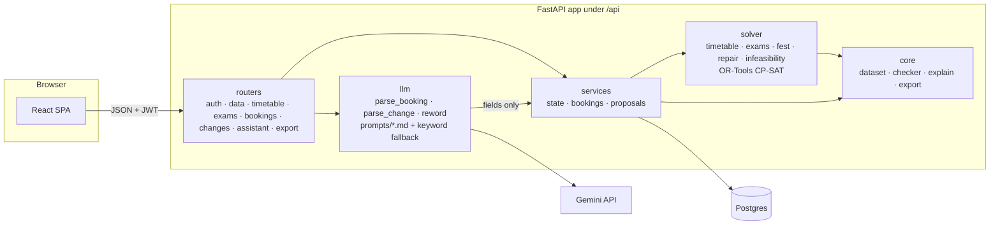

# CIT Campus Scheduler — Crunch Week

Timetable generation, midsem exam scheduling, Spectra-week venue booking and disruption handling for Chilika Institute of Technology.

> Work in progress: the engine, the API and the web frontend are built; deployment is next. Live link and screenshots will be added here.

## How it works

The LLM talks, the solver decides, and every decision has a reason you can check.



- `core/checker.py` decides validity. It mirrors `starter_pack/validator.py` rule for rule (tests compare the two). Solver output, manual moves, AI drafts and approvals all pass through it before anything is saved.
- The LLM only fills in forms and rewords reasons. Its output has no status or approval field. If it is down, slow or returns junk, the assistant falls back to keyword rules and the manual forms work unchanged.
- Disruptions (change files, faculty leave, requests) become **proposals**. The repair solver moves as few sessions as possible and the diff is shown. Nothing changes until the Admin approves, and approval re-checks against the timetable that is active at that moment.

## Tech stack

Python 3.12+ · FastAPI · SQLAlchemy 2 · Pydantic 2 · Google OR-Tools CP-SAT · Postgres (Neon) or SQLite locally · PyJWT + bcrypt · Gemini 2.5 Flash (optional). Frontend: React 19 + Vite + TypeScript + Tailwind 4, shadcn/ui-style components on Radix, TanStack Query, Motion. Full list with licences: [THIRD_PARTY.md](THIRD_PARTY.md). The visual design and its research: [frontend/DESIGN.md](frontend/DESIGN.md).

## Run it locally

```bash
python -m venv .venv
.venv/bin/pip install -r requirements-dev.txt        # Windows: .venv\Scripts\pip
cp .env.example .env                                  # optional; every variable has a local default
.venv/bin/python -m uvicorn backend.app.main:app --port 8000
```

Open http://localhost:8000/api/docs for the interactive API. With no `DATABASE_URL` the app uses a local SQLite file (`local.db`) and seeds the demo data on first start.

Then the web app (Node 20+), in a second terminal:

```bash
cd frontend
npm ci
npm run dev          # http://localhost:5173, proxies /api to :8000
```

Log in with one of the demo account buttons. To proxy to another API port, put `API_PROXY=http://localhost:8100` in `frontend/.env.local`. If the deployed `DEMO_PASSWORD` isn't `demo1234`, build with `VITE_DEMO_PASSWORD` set so the one-click buttons work.

Tests:

```bash
.venv/bin/python -m pytest backend/tests/api -q                     # API, ~3 min
.venv/bin/python -m pytest backend/tests/engine -q -m "not slow"     # engine, ~7 min
cd frontend && npm test && npm run build                            # frontend unit tests, type check, production build
```

Produce the two export files from a running app (local or deployed) and check them with the official validator:

```bash
.venv/bin/python scripts/make_exports.py --base-url http://localhost:8000
```

Score the booking/change assistant on tricky requests (Gemini if `GEMINI_API_KEY` is set, else the keyword fallback):

```bash
.venv/bin/python scripts/eval_llm.py
```

On a PaaS host (Railway, Render, Fly), the `Procfile` starts the API with `uvicorn backend.app.main:app --host 0.0.0.0 --port $PORT`.

## Deploy to Vercel

`vercel.json` runs the API as one Python function (`api/index.py`, up to 300 s per request) under `/api`. The frontend still has to be added to it: a static build of `frontend/` (`npm ci && npm run build`, output `frontend/dist`), with every path outside `/api` falling back to `index.html` so deep links like `/timetable?view=room&id=AUD` work on reload.

1. **Create the project.** Either import the GitHub repo at vercel.com (Add New → Project; framework preset "Other"; leave the build settings alone), or deploy from a laptop with the CLI: `npm i -g vercel`, `vercel login`, `vercel link`.
2. **Add a database.** In the project's Storage tab, connect Neon (Postgres). It sets `DATABASE_URL`. Without it the app still starts, on a throwaway SQLite file, and `/api/health` says so. That's fine for a first check, not for judges.
3. **Set the environment variables** (Settings → Environment Variables, or `vercel env add NAME`):
   - `JWT_SECRET`: required. A deployed app refuses to start without 32+ random characters. Generate one with `python -c "import secrets; print(secrets.token_urlsafe(48))"`.
   - `DEMO_PASSWORD`: the password for every demo account. List it in the Demo accounts table below.
   - `GEMINI_API_KEY`: optional. Without it the assistant uses keyword rules.
   - `SOLVER_TIME_LIMIT_S` (default 60) and `SOLVER_WORKERS` (default 8). Lower the workers if the function has few CPUs.
4. **Deploy** (the Deploy button, or `vercel deploy --prod`). Then open `https://<project>.vercel.app/api/health`: `ok` should be true, `db` should be `ok` (not "temporary"), and `llm` should be `configured`. `/api/docs` has an Authorize button: paste the token from `POST /api/auth/login`.
5. **Measure the solver on Vercel's CPUs**, from any machine with this repo:
   ```bash
   python scripts/make_exports.py --base-url https://<project>.vercel.app --password <DEMO_PASSWORD> --out /tmp/vercel-check
   ```
   It prints the solve time and soft penalty, then runs the official validator on both files. A soft penalty well above 3, or a timeout, means too little CPU: raise `SOLVER_TIME_LIMIT_S` (at most about 280) or move the backend.

If the deploy fails on function size, or the solver is too slow, move the backend to Railway or Render (the `Procfile` covers it). Keep the frontend on Vercel, and change the `/api/(.*)` rewrite in `vercel.json` to `https://<backend-host>/api/$1`.

## Demo accounts

Every account uses the password in `DEMO_PASSWORD` (default `demo1234` locally). The Admin's "reset demo data" (`POST /api/admin/reset`) restores the starter dataset, removes every timetable, request and proposal, and keeps the accounts.

| Email | Role | What to try |
| --- | --- | --- |
| `admin@cit.demo` | Admin (Dean's office) | Generate the timetable and exams, decide Spectra week, upload a change file, approve proposals, export, reset |
| `cse.coord@cit.demo` | Department coordinator (CSE) | Book rooms for CSE events, approve bookings of CSE labs, move CSE sessions |
| `ece.coord@cit.demo` | Department coordinator (ECE) | Same for ECE; shows that a coordinator can't approve their own request |
| `faculty@cit.demo` | Faculty (F01, Dr. Ananya Mishra) | Own timetable, mark unavailability, ask the assistant to move a class |
| `club@cit.demo` | Club representative (Robotics Club) | Submit venue requests in plain English or Hinglish, cancel them, see each status and reason |

The faculty and coordinator accounts follow the loaded dataset: the first faculty member and the first two teaching departments.

## API overview

All routes are under `/api` and need `Authorization: Bearer <token>` except login, the demo-account list and health. Errors always look like `{"error": {"code", "message", "details"}}`.

| Area | Routes |
| --- | --- |
| Auth | `POST /auth/login`, `GET /me`, `GET /auth/demo-accounts` |
| Data | `POST /data/dataset` (Admin; JSON file), `GET /data/summary`, `GET/PUT /settings` (priority order, lab owners), `POST /admin/reset` |
| Timetable | `POST /timetable/generate`, `GET /timetable?view=group\|faculty\|room\|all&id=&week=regular\|spectra`, `POST /timetable/check-move`, `POST /timetable/manual`, `GET /explain/session/{id}` |
| Views | `GET /dashboard`, `GET /rooms/free?day&from&to&capacity&needs&types&week` |
| Exams | `POST /exams/generate`, `GET /exams` |
| Spectra week | `POST /bookings/check`, `POST /bookings`, `GET /bookings?mine=1`, `POST /bookings/{id}/cancel`, `POST /bookings/{id}/decide`, `POST /fest/decide-all`, `GET /fest`, `GET /explain/booking/{id}` |
| Changes | `POST /changes/file`, `POST /changes`, `POST /faculty/unavailability`, `GET /changes`, `GET /changes/{id}`, `POST /changes/{id}/approve`, `POST /changes/{id}/reject` |
| Assistant | `POST /assistant/booking`, `POST /assistant/change` |
| Export | `GET /export/schedule.json?after=0\|1` |
| Health | `GET /health?deep=1` |

## Rules worth knowing

- **Priority.** Exams > classes > institute events > guest lectures > department events > club events, ties to the earlier submission. A role can't claim more than its cap (a club asking for "institute event" is a club event, and the reason says so). The Admin can reorder the list in settings.
- **Who approves what.** Code decides every booking. A booking of a department's lab waits for that department's coordinator; if the coordinator made it, it waits for the Admin. Timetable changes wait for the Admin. Nobody approves their own request. The Admin's own change files and manual moves are shown as proposals and the Admin applies them after reviewing the diff.
- **App bookings never move classes.** Only the dataset's approved institute events may displace a class, and then only for Week 7 (`session_overrides`).

## Known limitations

- Login is seeded demo accounts only: no sign-up, no password reset.
- Long solves run inside the request (no job queue); the solver time limit is set by `SOLVER_TIME_LIMIT_S`.
- Solution quality depends on CPU cores. With one core the timetable is valid but less optimised in the same time.
- Without `GEMINI_API_KEY` the assistant uses keyword rules: fine for plain requests, weaker on vague or conditional ones.

## Repo layout

```
backend/app/core/      dataset loading, checker (mirrors the validator), explanations, export
backend/app/solver/    CP-SAT timetable, exams, Spectra-week decisions, repair, infeasibility
backend/app/services/  state, bookings, proposals: what the routers call
backend/app/routers/   HTTP endpoints
backend/app/llm/       Gemini client, prompts/, parsers with keyword fallback
backend/tests/         engine/ (solver + checker vs validator), api/ (HTTP flows)
api/index.py           Vercel function entry; vercel.json routes /api/* to it
frontend/              React SPA: src/pages (one per screen), src/components (board, timetable, booking,
                       changes, ui), src/api (typed client); DESIGN.md is the design system
scripts/make_exports.py  drives the app's API to produce exports/
starter_pack/          organisers' starter pack: dataset, validator, examples (never edited)
exports/               schedule.json and schedule_after.json produced by the app
docs/                  DESIGN.md (product + system design), PLAN.md (build plan)
```

## Validator

```bash
python starter_pack/validator.py --data starter_pack/data/cit_public.json --schedule exports/schedule.json
python starter_pack/validator.py --data starter_pack/data/cit_public.json --schedule exports/schedule_after.json \
    --disruption starter_pack/examples/sample_disruption.json --baseline exports/schedule.json
```
