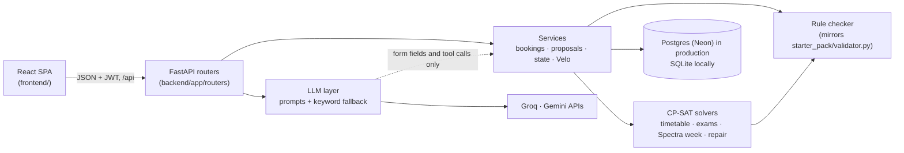

<div align="center">

# Velora

**Campus scheduling where the code decides and the AI only helps.**

Timetable, midsem exams, Spectra-week and regular-week venue bookings, and timetable repair after a disruption, for Chilika Institute of Technology. A CP-SAT solver and a rule checker make every decision. The assistant, Velo, reads requests, fills in forms and explains results.

[](https://fastapi.tiangolo.com)
[](https://developers.google.com/optimization)
[](https://react.dev)
[](https://www.typescriptlang.org)
[](https://vite.dev)
[](https://neon.tech)
[](https://velora-campus.vercel.app)

**[Live App](https://velora-campus.vercel.app)** · **[AI usage](AI_USAGE.md)** · **[Third-party](THIRD_PARTY.md)**

</div>

---

## Try it

### **[velora-campus.vercel.app](https://velora-campus.vercel.app)**

Every demo account uses the password **`demo1234`**, on the live app and locally. The **Demo for judges** tiles on the login page log in with one click.

| Role | Email | Can |
|---|---|---|
| Admin (Dean's Office) | `admin@cit.demo` | Generate the timetable and exams, apply change files, approve changes, export, reset demo data |
| Department Coordinator | `<dept>.coord@cit.demo` for `cse`, `ece`, `ee`, `me`, `ce`, `ma`, `ph`, `hss` | Book rooms for department events, approve bookings of the department's labs |
| Faculty | `f01@cit.demo` … `f40@cit.demo` | See their week, mark time they can't teach, ask for a class to move |
| Club Representative | `robotics-club`, `coding-club`, `dramatics-society`, `music-club`, `e-cell` … `@cit.demo` (11 clubs, all on the login page) | Request venues in English or Hinglish, typed or spoken, and track the decision |

**The judge path takes about five minutes:**

| | Do this | What to watch |
|---|---|---|
| 1 | Log in as **Admin**. On **Overview**, press **Generate timetable** | Takes about a minute. The dashboard then shows 0 hard violations, the soft penalty and room use |
| 2 | Open **Timetable** and switch between a student group, a faculty member and a room | Click any class to see why it sits there |
| 3 | Open **Find a room**, pick a day, a time and a size | Free rooms that fit, straight from the live timetable |
| 4 | Open **Changes** and drop in [`sample_disruption.json`](starter_pack/examples/sample_disruption.json) | A minimal-move proposal with a before/after diff. Press **Apply this change** |
| 5 | Log in as a **Club** and open Velo (bottom right). Send `Kal shaam 5 baje seminar hall chahiye 80 logon ke liye, Spectra week` | Velo drafts the booking, the rule checker decides it, and nothing is sent until you confirm |

**Reset demo data** (Admin → Data and export, or `POST /api/admin/reset`) restores the starter dataset and clears every timetable, request and proposal. Accounts are kept.

> LLM output never carries a status or an approval. Anything Velo prepares is a card the person confirms, and the services check it again. See [Architecture](#architecture).

---

## Features

| Area | What it does |
|---|---|
| **Timetable** | CP-SAT builds the week from the starter dataset with 0 hard violations, then minimises the soft penalty. Views by student group, faculty member and room |
| **Explanations** | Click a class to see why it is there, and how many other slots break a hard rule. The Admin can move a class by hand; the move is checked before it is saved |
| **Midsem exams** | A separate solve for the exam timetable |
| **Spectra week** | Fest venue requests decided together by the solver, in priority order, with alternatives offered when the first choice is taken |
| **Regular-week bookings** | Each request is checked against the live timetable and decided in turn, so two people asking for the same room can't both get it |
| **Find a room** | Free rooms for a day, a time range and a headcount |
| **Changes** | A faculty absence or a change file becomes a minimal-move repair with a diff. The timetable changes only when the Admin applies it |
| **Velo** | Chat assistant for every role, in English, Hinglish or Hindi script, typed or spoken. Finds rooms, drafts bookings and change requests, explains decisions. Falls back to keyword rules when the model is unavailable |
| **Export** | `schedule.json` in the organisers' format, before and after a disruption, with the validator's report |
| **Themes** | Light and dark |

**Booking priority:** Exams > Classes > Institute events > Guest lectures > Department events > Club events. Ties go to the earlier request, and a role can't claim a higher category than its own.

---

## Architecture



- **Code decides, the LLM helps.** Every booking, move and repair goes through `backend/app/core/checker.py` and the solvers.
- **Works without AI.** If a key is missing, rate-limited or slow, keyword rules take over, and the manual booking form never calls an LLM.
- **Changes need approval.** A proposal is checked again when the Admin applies it.
- **One booking at a time.** Regular-week bookings are decided in turn behind a lock.

---

## Tech stack

| Layer | Choice |
|---|---|
| API | Python, FastAPI 0.162, SQLAlchemy 2.1, Pydantic 2.14, PyJWT, bcrypt |
| Solver | Google OR-Tools 9.15 (CP-SAT) |
| Database | PostgreSQL on Neon (production), SQLite (local) |
| AI | Groq `openai/gpt-oss-120b` (Velo's tool calling), Google `gemini-3.5-flash-lite` (form filling, intent sorting, voice) |
| Frontend | React 19.2, TypeScript 5.9, Vite 7.3, Tailwind CSS 4.1, Radix UI, TanStack Query 5 |
| Motion | Motion 12, GSAP 3.13, three.js 0.186 |
| Tests | pytest, Vitest 3.2, Testing Library |
| Hosting | Vercel (Python function for `/api`, static build for the rest) |

Every library with its version and licence is in [THIRD_PARTY.md](THIRD_PARTY.md). Every model, prompt and coding tool is in [AI_USAGE.md](AI_USAGE.md).

---

## API

All routes sit under `/api`. Swagger is at `/api/docs` on a running API.

| Area | Routes |
|---|---|
| Auth | `POST /auth/login` · `POST /auth/signup` · `GET /auth/demo-accounts` · `GET /me` · `POST /auth/password` |
| Timetable | `POST /timetable/generate` · `GET /timetable` · `POST /timetable/check-move` · `POST /timetable/manual` · `GET /explain/session/{id}` |
| Exams | `POST /exams/generate` · `GET /exams` |
| Bookings | `POST /bookings/check` · `POST /bookings` · `GET /bookings` · `POST /bookings/{id}/decide` · `POST /bookings/{id}/cancel` · `GET /explain/booking/{id}` |
| Spectra week | `GET /fest` · `POST /fest/decide-all` |
| Changes | `POST /changes/file` · `POST /changes` · `POST /faculty/unavailability` · `GET /changes` · `POST /changes/{id}/approve` · `POST /changes/{id}/reject` |
| Velo | `POST /velo` · `POST /velo/actions/{id}/confirm` · `POST /velo/actions/{id}/discard` · `GET /velo/conversations/{id}` |
| Assistant | `POST /assistant/booking` · `POST /assistant/change` · `POST /assistant/transcribe` |
| Views | `GET /dashboard` · `GET /rooms/free` |
| Data | `GET /data/summary` · `POST /data/dataset` · `GET` `PUT /settings` · `GET /users` · `POST /admin/reset` · `GET /export/schedule.json` · `GET /health` |

---

## Getting started

**Requirements:** Python 3.13 or 3.14, Node 20.19+ (tested with Node 24). No API keys or database are needed locally.

```bash
git clone https://github.com/me-adityaraj8/crunchweek-cit-scheduler.git
cd crunchweek-cit-scheduler
python3 -m venv .venv
.venv/bin/pip install -r requirements-dev.txt        # Windows: .venv\Scripts\pip
cp .env.example .env                                 # optional: every value has a local default
```

Run the API (terminal 1). It creates `local.db` (SQLite) and the demo accounts on first start.

```bash
.venv/bin/python -m uvicorn backend.app.main:app --port 8000
```

Run the web app (terminal 2), then open http://localhost:5173. It forwards `/api` to port 8000.

```bash
cd frontend
npm ci
npm run dev
```

### Environment variables

All of them are in [`.env.example`](.env.example) with a comment each. Locally they can all stay empty.

| Variable | Needed | Purpose |
|---|---|---|
| `DATABASE_URL` | deployed | Postgres connection string. Empty = SQLite file `local.db` |
| `JWT_SECRET` | deployed | Signs login tokens. A deployed app refuses to start without it |
| `DEMO_PASSWORD` | no | Password for every demo account, default `demo1234` |
| `GROQ_API_KEY` · `GROQ_MODEL` | no | Velo's agent. Empty = keyword rules |
| `GEMINI_API_KEY` · `GEMINI_MODEL` | no | Form filling, intent sorting and voice. Empty = keyword rules |
| `LLM_PROVIDER` | no | `groq` or `gemini` for Velo's agent |
| `AGENT_MAX_STEPS` · `AGENT_RETRIES` · `AGENT_TIMEOUT_S` · `LLM_TIMEOUT_S` | no | Limits on model calls before falling back |
| `VELO_CONTEXT_TTL_MIN` · `VELO_ACTION_TTL_MIN` | no | When a Velo conversation starts fresh, and when an unconfirmed action expires |
| `SOLVER_TIME_LIMIT_S` · `SOLVER_WORKERS` | no | Solver time limit and CPU threads |
| `TEAM_NAME` | no | Written into exported `schedule.json` files |
| `VITE_DEMO_PASSWORD` | no | Frontend build only: the password the one-click demo tiles use |

### Commands

| Command | Effect |
|---|---|
| `.venv/bin/python -m pytest backend/tests/api -q` | API tests |
| `.venv/bin/python -m pytest backend/tests/engine -q -m "not slow"` | Solver and checker tests (drop `-m` for the slow ones too) |
| `cd frontend && npm test` | Frontend tests |
| `cd frontend && npm run build` | Type check and production build |
| `.venv/bin/python scripts/make_exports.py --base-url http://localhost:8000` | Regenerate `exports/` from a running API |
| `.venv/bin/python scripts/eval_llm.py --rules-only` | Assistant checks against the keyword rules, no key needed |
| `.venv/bin/python scripts/eval_velo.py` | Velo's edge-case checks (22 cases) |

The solver tests use time limits, so run one suite at a time.

---

## Exports and validator

`exports/schedule.json` (the public dataset) and `exports/schedule_after.json` (after `sample_disruption.json`) were produced by the app. Check them with the official validator:

```bash
python3 starter_pack/validator.py --data starter_pack/data/cit_public.json --schedule exports/schedule.json
python3 starter_pack/validator.py --data starter_pack/data/cit_public.json --schedule exports/schedule_after.json \
  --disruption starter_pack/examples/sample_disruption.json --baseline exports/schedule.json
```

Both report 0 hard violations.

---

## Project structure

```
crunchweek-cit-scheduler/
├── backend/app/
│   ├── core/              # dataset loading, rule checker, explanations, schedule.json export
│   ├── solver/            # CP-SAT: timetable, exams, Spectra week (fest), repair, infeasibility reasons
│   ├── services/          # bookings and the booking queue, proposals, state, Velo and its tools
│   ├── routers/           # HTTP endpoints, one file per area
│   ├── llm/               # Gemini and Groq clients, parsers with keyword fallback
│   │   └── prompts/       # every prompt the app sends
│   ├── models.py          # database tables
│   └── schemas.py         # request and response shapes
├── backend/tests/
│   ├── engine/            # solver and checker, compared with the official validator
│   └── api/               # HTTP flows, roles, bookings, changes, Velo
├── frontend/src/
│   ├── pages/             # one file per screen
│   ├── components/        # UI by area
│   └── api/               # typed API client and query hooks
├── api/index.py           # Vercel entry for the API
├── vercel.json            # API + static build routing
├── scripts/               # make_exports.py, eval_llm.py, eval_velo.py
├── starter_pack/          # organisers' dataset, validator and examples (unchanged)
├── exports/               # schedule.json and schedule_after.json
└── docs/                  # design notes and build plan
```

---

## Testing

| Suite | Tests | Covers |
|---|---|---|
| `backend/tests/api` | 155 | Logins and roles, bookings and the booking queue, changes and approval, Velo with and without a model, relative days and clock times |
| `backend/tests/engine` | 404 (49 marked slow) | Solvers and rule checker, results compared with `starter_pack/validator.py` |
| `frontend` (Vitest) | 44 | API client, timetable layout, change diffs, Velo context, voice recording, time helpers |

The API and frontend suites, the build and the README setup were run from a fresh clone.

---

## Known limitations

- **AI depends on outside APIs.** On Groq's free tier the daily token limit can run out. Velo then answers with its keyword rules, which handle plain requests but are weaker on vague or conditional ones.
- **Solves run inside the request.** There is no background job queue; a solve is bounded by `SOLVER_TIME_LIMIT_S`. With fewer CPU cores the timetable stays valid but may be less optimised in the same time.
- **Accounts.** No email verification, password-reset email or login rate limit. Reset demo data also clears requests made from self-created accounts.
- **Booking queue.** Tested with simultaneous requests on SQLite. On Postgres it uses a transaction-level advisory lock, which hasn't been load-tested.

---

<div align="center">

Made by **Galaxy Flare** for CrunchWeek, IIT Bhubaneswar

</div>
