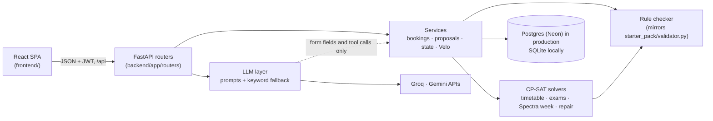

# Velora

Campus scheduling for Chilika Institute of Technology: the weekly timetable, midsem exams, Spectra-week and regular-week venue bookings, and timetable repair after a disruption. A CP-SAT solver and a rule checker decide everything. The AI assistant, Velo, only reads requests, fills in forms and explains decisions.

**Live app: [velora-campus.vercel.app](https://velora-campus.vercel.app)** · password **`demo1234`** for every demo account

| | |
| --- | --- |
| [Demo accounts](#demo-accounts) | [Try it in five minutes](#try-it-in-five-minutes) |
| [Architecture](#architecture) | [Project structure](#project-structure) |
| [Tech stack](#tech-stack) | [Setup](#setup) |
| [Exports and validator](#exports-and-validator) | [Known limitations](#known-limitations) |

Declarations: [AI_USAGE.md](AI_USAGE.md) (models, prompts, coding tools) · [THIRD_PARTY.md](THIRD_PARTY.md) (libraries and borrowed code)

## Demo accounts

Every account below uses the password `demo1234`, on the live app and locally. The login page's **Demo for judges** tiles log in with one click.

| Role | Email | Can |
| --- | --- | --- |
| Admin (Dean's Office) | `admin@cit.demo` | Generate the timetable and exams, apply change files, approve changes, export, **Reset demo data** |
| Department Coordinator | `<dept>.coord@cit.demo` for `cse`, `ece`, `ee`, `me`, `ce`, `ma`, `ph`, `hss` | Book rooms for department events, approve bookings of the department's labs |
| Faculty | `f01@cit.demo` … `f40@cit.demo` | See their week, mark time they can't teach, ask for a class to move |
| Club Representative | `robotics-club`, `coding-club`, `dramatics-society`, `music-club`, `e-cell` … `@cit.demo` (11 clubs, all on the login page) | Request venues in English or Hinglish, typed or spoken, and track the decision |

**Reset demo data** (Admin → Data and export, or `POST /api/admin/reset`) restores the starter dataset and clears every timetable, request and proposal. Accounts are kept.

## Try it in five minutes

1. Log in as **Admin**. On **Overview**, press **Generate timetable** (about a minute). The dashboard then shows 0 hard violations, the soft penalty and room use.
2. **Timetable**: switch between a student group, a faculty member and a room. Click any class to see why it sits there.
3. **Find a room**: pick a day, a time and a size.
4. **Changes**: drop in [`starter_pack/examples/sample_disruption.json`](starter_pack/examples/sample_disruption.json). Open the proposal to see the before/after diff, then press **Apply this change**.
5. Log in as a **Club** and open Velo (bottom right). Try `Kal shaam 5 baje seminar hall chahiye 80 logon ke liye, Spectra week`. Velo drafts the booking, the rule checker decides it, and nothing is sent until you confirm.

## Architecture



- **Code decides, the LLM helps.** Every booking, move and repair goes through `backend/app/core/checker.py` and the solvers. LLM output has no status or approval field, and anything Velo prepares is a card the person confirms; the services then check it again.
- **Works without AI.** If a key is missing, rate-limited or slow, keyword rules take over, and the manual booking form never calls an LLM.
- **Priority order** for bookings: Exams > Classes > Institute events > Guest lectures > Department events > Club events. Ties go to the earlier request, and a role can't claim a higher category than its own.
- **Changes need approval.** A disruption becomes a minimal-move proposal with a diff. The timetable changes only when the Admin applies it, after a fresh check.
- **One booking at a time.** Bookings are decided in turn, so two people asking for the same room at once can't both get it.

## Project structure

```text
backend/app/
  core/        dataset loading, rule checker, explanations, schedule.json export
  solver/      CP-SAT models: timetable, exams, Spectra week, minimal-move repair, infeasibility reasons
  services/    application logic: bookings (and the booking queue), proposals, state, Velo and its tools
  routers/     HTTP endpoints, one file per area
  llm/         Gemini and Groq clients, parsers with keyword fallback, prompts/ (every prompt)
  models.py    database tables      schemas.py  request and response shapes
backend/tests/
  engine/      solver and checker, compared with the official validator
  api/         HTTP flows, roles, bookings, changes, Velo
frontend/src/
  pages/       one file per screen      components/  UI by area      api/  typed API client
api/index.py   Vercel entry for the API          vercel.json  API + static build routing
scripts/       make_exports.py (exports/ from a running app), eval_llm.py and eval_velo.py (assistant checks)
starter_pack/  organisers' dataset, validator and examples (unchanged)
exports/       schedule.json and schedule_after.json, produced by the app
docs/          design notes and build plan
```

## Tech stack

| Layer | Used |
| --- | --- |
| Backend | Python, FastAPI, SQLAlchemy, Pydantic, PyJWT, bcrypt |
| Solver | Google OR-Tools CP-SAT |
| Database | Postgres on Neon (production), SQLite (local) |
| AI | Groq `openai/gpt-oss-120b` (Velo's tool calling), Google Gemini 3.5 Flash-Lite (form filling, intent sorting, voice) |
| Frontend | React 19, TypeScript, Vite, Tailwind CSS 4, Radix UI, TanStack Query, Motion, GSAP, three.js |
| Hosting | Vercel (Python function for `/api`, static build for the rest) |

Versions and licences are in [THIRD_PARTY.md](THIRD_PARTY.md).

## Setup

Needs Python 3.13 or 3.14 and Node 20.19+ (tested with Node 24). No API keys or database are needed to run locally.

```bash
git clone https://github.com/me-adityaraj8/crunchweek-cit-scheduler.git
cd crunchweek-cit-scheduler
python3 -m venv .venv
.venv/bin/pip install -r requirements-dev.txt        # Windows: .venv\Scripts\pip
cp .env.example .env                                 # optional: every value has a local default
```

Run the API (terminal 1). It creates `local.db` (SQLite) and the demo accounts on first start.

```bash
.venv/bin/python -m uvicorn backend.app.main:app --port 8000
```

Run the web app (terminal 2), then open http://localhost:5173. It forwards `/api` to port 8000.

```bash
cd frontend
npm ci
npm run dev
```

API docs (Swagger) are at http://localhost:8000/api/docs.

**Environment.** Every variable is listed with a comment in [`.env.example`](.env.example). For local runs all of them can stay empty. A deployed app needs `DATABASE_URL` and `JWT_SECRET`, and refuses to start without `JWT_SECRET`. `GROQ_API_KEY` and `GEMINI_API_KEY` turn on the AI features.

**Tests.** The solver tests use time limits, so run one suite at a time.

```bash
.venv/bin/python -m pytest backend/tests/api -q
.venv/bin/python -m pytest backend/tests/engine -q -m "not slow"
cd frontend && npm test && npm run build
```

## Exports and validator

`exports/schedule.json` (the public dataset) and `exports/schedule_after.json` (after `sample_disruption.json`) were produced by the app. To produce them again from a running API, and to check them with the official validator:

```bash
.venv/bin/python scripts/make_exports.py --base-url http://localhost:8000
python3 starter_pack/validator.py --data starter_pack/data/cit_public.json --schedule exports/schedule.json
python3 starter_pack/validator.py --data starter_pack/data/cit_public.json --schedule exports/schedule_after.json \
  --disruption starter_pack/examples/sample_disruption.json --baseline exports/schedule.json
```

## Known limitations

- **AI depends on outside APIs.** On Groq's free tier the daily token limit can run out. Velo then answers with its keyword rules, which handle plain requests but are weaker on vague or conditional ones.
- **Solves run inside the request.** There is no background job queue; a solve is bounded by `SOLVER_TIME_LIMIT_S`. With fewer CPU cores the timetable stays valid but may be less optimised in the same time.
- **Accounts.** No email verification, password-reset email or login rate limit. Reset demo data also clears requests made from self-created accounts.
- **Booking queue.** Tested with simultaneous requests on SQLite. On Postgres it uses a transaction-level advisory lock, which hasn't been load-tested.
