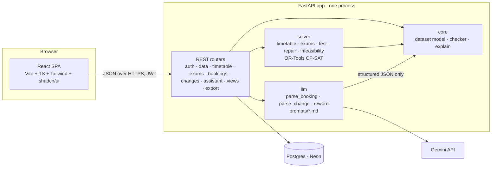

# Design — Velora

Status: draft for team approval. Nothing here is built yet.

Sources: `Problem statement.pdf`, `starter_pack/README.md`, `starter_pack/validator.py` (the validator is the scoring spec — where this doc and the validator disagree, the validator wins).

---

## 1. Intent

One line: **the LLM talks, the solver decides, and every decision has a reason you can check.**

Roughly 60 of the 100 marks are scored by `validator.py` (correctness 25, rescheduling 15, optimisation 10, bookings 10). The rest come from judges clicking through the live app with the README and demo accounts (AI 15, usability 10, UI 10, docs 5). So the order of priority is:

1. Zero hard violations on every export, every time (each one costs 3 marks).
2. Disruption repair that moves the fewest sessions, with a clear diff and an Admin approval step.
3. A booking assistant that survives tricky English/Hinglish input and rule-dodging, with the manual form working when the LLM is down.
4. A UI a first-time judge can use without help.

### Goals
- All 10 features in the problem statement, working end to end on the deployed link.
- `exports/schedule.json` and `exports/schedule_after.json` produced by the app.
- Every decision (slot, booking, rejection, repair) carries a reason generated from our own constraint checks.

### Non-goals
- Real SSO, email/WhatsApp notifications, native mobile app, multi-semester history.
- Generic support for other institutes' data formats — only the starter-pack format.

### Anti-goals (fail even if it "works")
- An LLM deciding validity anywhere. Validity checks depending on an LLM = 0 for correctness.
- Anything in the exports or video that's hand-made or hard-coded = disqualification.
- Hard-coding anything from `cit_public.json`. Judges reset the app, generate themselves and apply their own change file.
- Undeclared AI use (−10).

---

## 2. Product design

### Users and what they come for

| Role | Demo account | Main job in the app |
| --- | --- | --- |
| Admin (Dean's office) | `admin@cit.demo` | Load data, generate timetable + exams, decide Spectra week, apply change files, approve proposals, export, reset demo |
| Department coordinator | `cse.coord@cit.demo` (+ `ece.coord@cit.demo` to show "can't approve own") | Book rooms for department events, request changes to their department's sessions, approve bookings of their department's labs |
| Faculty | `f01@cit.demo` (mapped to F01) | See own timetable, mark unavailability, ask the assistant to move/add a session |
| Club representative | `club@cit.demo` | Submit/cancel venue requests in plain language, see status and reason |

Passwords for demo accounts are seeded from env and listed in the README.

### Key user journeys (these are also the video script)

1. **Generate** — Admin → Data → "Load starter dataset" → "Generate timetable" → progress → result card: `0 hard violations · soft penalty N · 189/189 placed` → timetable grid.
2. **Plain-language booking** — Club rep types "seminar hall kal shaam 6 baje, 2 ghante, 100 log, mic chahiye" → assistant fills the form, highlights guessed fields ("kal → TUE, assumed"), asks a follow-up if something essential is missing → user edits → Submit → code checks it → status + reason.
3. **Conflict blocked** — user picks a room/time already taken or not accessible → form shows the exact blocking rule and 2–3 valid alternatives. Same for manual scheduling by Admin.
4. **Spectra week** — Admin → Spectra week → "Decide all" → board shows each request approved / alternative / rejected with reason; click a request to see who it lost to and why.
5. **Disruption** — Admin uploads `sample_disruption.json` (or a judge's file) → proposal: before/after grid, "N sessions moved (x time, y room only), 0 hard violations" → Approve → live timetable updated. If no fix exists: list of the conflicting constraints.
6. **Faculty request** — F01 types "I can't take Monday 8 AM classes from next week, move my MA101 lecture" → parsed intent shown → repair proposal → goes to Admin for approval.
7. **Explain** — click any session or booking → "Why here?" panel with the reasons computed by the checker; optional "explain in plain words" (LLM rewords the computed facts only).
8. **Dashboard** — hard/soft score, pending approvals, current conflicts, room utilisation heatmap.

### MVP scope

**Must-have (all needed for marks):**
- Dataset load (starter pack JSON) + Admin reset demo data
- Timetable solver (CP-SAT) + our own checker
- Exam scheduler
- Spectra week decisions (priority-ordered, inversion-free, with reasons) incl. session overrides for institute events
- Booking form (manual) + LLM parser that fills it + follow-up questions
- Change files (all 5 change types) → minimal-move repair → diff → Admin approve
- Infeasibility report (which constraints conflict)
- Faculty change requests via assistant → proposal → approval
- Views: by group / faculty / room, find a free room, pending approvals, conflicts, utilisation
- Explanations computed by code
- Export `schedule.json` (download button + used to produce `exports/`)
- 4 roles, "nobody approves own request", demo accounts
- README, AI_USAGE.md, THIRD_PARTY.md, .env.example, architecture diagram

**Should-have:**
- Spectra week board with "lost to whom" replay
- Faculty marks own unavailability from the UI (becomes a change proposal)
- Admin can change priority order (default = dataset order)
- Recurring requests ("every Mon and Wed") split into linked bookings (`series_id`)

**Stretch (only after validator is at 0 hard on all three checks):**
- Booking-aware timetable: add the Spectra requests as optional weighted intervals inside the timetable solve, so the base timetable leaves room for them. Must still pass our own inversion check, else fall back to greedy.
- "Explain in plain words" via LLM on top of computed reasons.

**Mocked / not real — say so in the README:**
- Login is seeded demo accounts with passwords, no sign-up, no password reset.
- Nothing in the judged flows is mocked.

---

## 3. System design

### 3.1 Architecture



Rules baked into the architecture:
- `core/checker.py` is the single source of truth for validity. Solver output, LLM output, manual edits and imported data all go through it before anything is saved.
- The LLM module returns typed objects (Pydantic). It never writes to the DB and never returns a decision.
- One backend process (modular monolith). No queues, no microservices. Solves run in-process with a time limit.

### 3.2 Why this stack

| Choice | Why | Rejected |
| --- | --- | --- |
| Python + FastAPI | Validator is Python, so the checker can be cross-tested against it; OR-Tools is first-class in Python; Pydantic gives typed LLM output | Node/Express (no good CP solver) |
| OR-Tools CP-SAT | Exact solver for this exact problem shape (assignment + no-overlap + soft penalties); returns infeasible cores for "which constraints conflict" | Hand-written greedy/GA (can't guarantee 0 hard violations or minimal moves) |
| React + Vite SPA | App is a logged-in dashboard; no SEO/SSR needed; fewer moving parts than Next.js | Next.js (SSR and server functions add complexity and Vercel's 10s function timeout tempts proxying solves through it) |
| Tailwind + shadcn/ui | Fast, consistent, accessible components | — |
| Postgres on Neon (free) | Real persistence that survives backend restarts; doesn't pause for a week like Supabase free | SQLite on free hosts (disk wiped on restart/redeploy) |
| Gemini 3.8 Flash (free tier) | Free, supports JSON schema output, good with Hinglish | Paid APIs |
| Hosting: everything on Vercel (team decision). SPA as static build; FastAPI as a Vercel Python function under `/api`; Neon via Vercel's Postgres integration | One deploy, one URL, no sleeping server, free Hobby tier. Python functions get up to ~300s and 2 GB on Hobby with Fluid compute, enough for a 60s CP-SAT solve | Render/Koyeb free (0.1 vCPU, sleeps) — fallback only if a Vercel check below fails |

**Must be validated in hour 1, not assumed:** (a) the `ortools` wheel fits Vercel's Python function size limit, (b) a CP-SAT solve of the real dataset finishes inside the function's max duration on Vercel's CPU (cold start included), (c) Neon connects from the function, (d) the Gemini key returns JSON-schema output from the function. Function state is not kept between calls, so everything lives in Postgres. If (a) or (b) fails, the backend moves to Render/Railway and the SPA stays on Vercel.

### 3.3 Backend modules

```
backend/
  app/
    main.py                FastAPI app, router wiring
    config.py              env settings (pydantic-settings)
    db.py  models.py       SQLAlchemy engine + tables
    auth.py                JWT login, role guard, "not your own request" guard
    routers/
      auth.py data.py timetable.py exams.py bookings.py
      changes.py assistant.py views.py export.py admin.py
    core/
      dataset.py           load/validate starter-pack JSON, apply change files
      model.py             typed Session, Room, Faculty, Assignment...
      checker.py           OUR hard + soft rules (H1–H14, S1–S6, B*, E*) — mirrors validator
      explain.py           "why here / why not there" from checker results
      priority.py          effective category (role cap), outranks()
    solver/
      timetable.py         CP-SAT weekly timetable
      exams.py             CP-SAT exam slots + room sets
      fest.py              Spectra week: priority-ordered placement + overrides
      repair.py            minimal-move re-solve from a baseline
      infeasible.py        assumption literals → conflicting constraint list
    llm/
      client.py            Gemini call, timeout, retries, "unavailable" fallback
      schemas.py           BookingDraft, ChangeIntent, FollowUp
      parse_booking.py parse_change.py reword.py
      prompts/*.md         every prompt lives here (declared in AI_USAGE.md)
  tests/
    test_checker_matches_validator.py   random + solver schedules: our checker == validator.py
    test_solver_zero_hard.py
    test_repair_sample_disruption.py
    test_llm_guardrails.py              adversarial inputs → checker still rejects
api/index.py          Vercel entry: imports backend.app.main:app
vercel.json           build SPA, route /api/* to the Python function, maxDuration
frontend/
  src/
    api/          typed client (types generated from FastAPI OpenAPI)
    pages/        see 3.6
    components/   see 3.6
    lib/          time/period helpers, role helpers
docs/DESIGN.md
exports/
starter_pack/     organisers' files, never edited
```

### 3.4 Solver approach

**Timetable (CP-SAT).** For each session, pre-filter candidate `(day, start, room)` triples by: room type, room `allowed_uses` matches kind, capacity, accessibility, lab start P2/P6, no lunch crossing, ends ≤ P9, fixed slot, faculty and room unavailability. One boolean per candidate (~tens of thousands total, fine for CP-SAT).
- exactly one candidate per session
- room / faculty occupancy ≤ 1 per (day, period)
- group occupancy ≤ 1 per (day, period), where all sessions in one `basket_slot` count as one item
- basket sessions share one `(day, start)` variable
- faculty daily hours ≤ `max_hours_per_day`
- objective = validator soft penalty exactly: S1 (2/hour in avoided slot), S2 (gaps per group-day), S3 (3 × hours over 6), S4 (3 × repeat lectures of a course per day, incl. basket rule), S5 (size < 40% capacity), S6 (uses P9)
- time limit ~30–60s, multi-worker, keep best solution; checker runs on the result before saving.

**Exams.** Variables: exam → (day, AM/PM), and exam × room × slot booleans. Seats = Σ capacity//2 ≥ size; rooms must allow `exam`; one exam per room per slot; one exam per group per slot. Objective: minimise 5 × extra exams per group-day.

**Spectra week (fest.py).** Process non-cancelled requests in priority order (effective category after role cap, then `submitted_at`). For each: try the requested room then every fitting room inside its windows (event-allowed, type, capacity, needs incl. accessible, room free in the Week-7 view, mandatory groups free) → `approved`. If none: try other days/periods → `alternative_offered`. Else `rejected` with the specific blocking reason. Greedy in priority order cannot produce a priority inversion as the validator defines it; our checker verifies that anyway. Institute events may displace regular sessions: the displaced sessions get re-placed for Week 7 via `repair.py` and written as `session_overrides`. Cancelled requests are always rejected with reason "Cancelled by requester".

**Repair (repair.py).** Same model as the timetable with the change applied, plus a baseline hint. Objective: `1000 × (sessions whose day, start or room changed) + soft penalty`. Room-only changes count as moves in the validator, so they're penalised the same. Output = proposal with the diff.

**Infeasibility (infeasible.py).** Each change and each hard-constraint family gets an assumption literal. If infeasible, CP-SAT's `sufficient_assumptions_for_infeasibility` gives the smallest set we can name in plain words ("F07 off Monday" + "CR-102 closed" + "CSE-2 needs 3 lab blocks in CS labs").

**Manual scheduling and AI proposals** never go to the solver for validity — they go through `checker.py`. A manual move that breaks a hard rule is blocked with the rule and suggested valid slots.

### 3.5 Data model

Most scheduling state is stored as JSON blobs keyed to versions. The solver works in memory; Postgres keeps versions, requests, approvals and an audit trail.

```mermaid
erDiagram
  USER ||--o{ BOOKING_REQUEST : submits
  USER ||--o{ CHANGE_PROPOSAL : requests
  USER ||--o{ AUDIT_LOG : acts
  DATASET ||--o{ TIMETABLE_VERSION : has
  DATASET ||--o{ EXAM_SCHEDULE : has
  TIMETABLE_VERSION ||--o{ CHANGE_PROPOSAL : base
  TIMETABLE_VERSION ||--o{ FEST_DECISION : week7
  BOOKING_REQUEST ||--o| FEST_DECISION : decided_by

  USER { int id PK; string email; string name; string role; string department; string faculty_id; string password_hash }
  DATASET { int id PK; string dataset_id; jsonb data; jsonb applied_changes; bool active; timestamp loaded_at }
  TIMETABLE_VERSION { int id PK; int dataset_fk FK; int parent_id; jsonb assignments; jsonb soft; int hard_count; string status; int created_by; timestamp created_at }
  EXAM_SCHEDULE { int id PK; int dataset_fk FK; jsonb assignments; int penalty; timestamp created_at }
  BOOKING_REQUEST { string id PK; string source; int created_by FK; string requester; string role; string department; string requested_category; string title; int attendance; int duration_periods; jsonb windows; jsonb room_types; jsonb needs; string requested_room; jsonb mandatory_for_groups; string series_id; text raw_text; timestamp submitted_at; string status }
  FEST_DECISION { int id PK; int version_fk FK; string request_id FK; string status; string day; int start_period; int end_period; string room_id; text reason; jsonb reason_facts; int decided_by }
  CHANGE_PROPOSAL { int id PK; string kind; jsonb payload; int base_version FK; jsonb proposed_assignments; jsonb diff; int moved; int hard_count; string status; jsonb conflicts; int requested_by FK; int decided_by; timestamp decided_at }
  AUDIT_LOG { int id PK; int actor FK; string action; string entity; jsonb payload; timestamp at }
```

`TIMETABLE_VERSION.status` ∈ `active | proposed | archived` (exactly one active). Week-7 session overrides live in `FEST_DECISION.reason_facts`/a version's `overrides` field. `CHANGE_PROPOSAL.status` ∈ `pending | approved | rejected | infeasible`.

### 3.6 API

All JSON. Auth: `Authorization: Bearer <jwt>`. Errors: `{"error": {"code": "...", "message": "...", "details": {...}}}`. Long solves are synchronous with a configurable limit (default 60s), well under the Vercel function's max duration. SPA and API share one origin (`/api`), so no CORS.

| Method & path | Who | Request → Response |
| --- | --- | --- |
| `POST /auth/login` | all | `{email, password}` → `{token, user:{id,name,role,department,faculty_id}}` |
| `GET /me` | all | → user |
| `POST /admin/reset` | admin | → reloads starter dataset, clears versions/requests/proposals, reseeds |
| `POST /data/dataset` | admin | multipart JSON file → `{dataset_id, counts}` (validated shape) |
| `GET /data/summary` | all | → counts, rooms, faculty, groups (for pickers) |
| `POST /timetable/generate` | admin | `{time_limit_s?}` → `{version_id, hard_count, soft:{S1..S6,total}, placed, solve_ms}` |
| `GET /timetable?view=group|faculty|room&id=` | role-scoped | → `{entries:[{session_id, course, kind, day, start, duration, room, faculty, groups}]}` |
| `POST /timetable/manual` | admin, coordinator (own dept) | `{session_id, day, start_period, room_id}` → `{ok, violations[], suggestions[]}` or a pending proposal |
| `GET /explain/session/{id}` | all | → `{placed_at, facts:[{rule, text}], rejected_alternatives:[{slot, blocked_by}]}` |
| `POST /exams/generate` | admin | → `{exams:[{exam_id, day, session, rooms}], penalty, hard_count}` |
| `GET /exams` | all | → exams |
| `POST /assistant/booking` | all | `{text, today?}` → `{draft: BookingDraft, guessed_fields[], follow_up: string|null, llm:"ok"|"unavailable"}` |
| `POST /bookings/check` | all | BookingDraft → `{valid, violations[], alternatives[]}` (pure code) |
| `POST /bookings` | all | BookingDraft → `{request_id, status, reason}` |
| `GET /bookings?mine=1` | all | → requests with status + reason |
| `POST /bookings/{id}/cancel` | owner | → updated request |
| `POST /bookings/{id}/decide` | admin; coordinator for own dept labs; never own | `{status, room_id?, day?, start?, reason}` → decision (checker-validated) |
| `POST /fest/decide-all` | admin | → `{decisions[], overrides[], score, inversions[]}` |
| `GET /fest` | all | → board data |
| `GET /explain/booking/{id}` | owner, admin | → `{status, facts[], lost_to?}` |
| `POST /changes/file` | admin | change-file JSON → proposal |
| `POST /assistant/change` | faculty, coordinator | `{text}` → `{intent: ChangeIntent, follow_up}` |
| `POST /changes` | faculty, coordinator, admin | ChangeIntent → proposal |
| `GET /changes?status=` | role-scoped | → proposals |
| `GET /changes/{id}` | role-scoped | → `{diff:[{session_id, before, after}], moved, time_changed, room_only, hard_count, soft_before, soft_after, conflicts?}` |
| `POST /changes/{id}/approve` · `/reject` | admin, never own | → new active version / rejected |
| `POST /faculty/unavailability` | faculty (self) | `{day, periods, reason}` → proposal |
| `GET /dashboard` | all (scoped) | → `{hard_count, soft, pending_approvals, conflicts[], utilisation:{room:{day:{period:0/1}}}}` |
| `GET /rooms/free?day&from&to&capacity&needs` | all | → rooms free for that window |
| `GET /export/schedule.json?after=0|1` | admin | → file in the starter-pack export format |

Typed objects (Pydantic, mirrored in TS):

```
BookingDraft  { title, attendance, duration_periods, windows:[{day, from_period, to_period}],
                room_types[], needs[], requested_room?, mandatory_for_groups[],
                requested_category, series?: {days[], ...} }
ChangeIntent  { type: faculty_unavailable|move_session|add_session|remove_session,
                session_id?, faculty_id?, days?, periods?, target?: {day, start_period, room_id?}, reason }
```

### 3.7 External integrations

| Integration | Used for | Failure behaviour |
| --- | --- | --- |
| Gemini API | parse booking text, parse change text, reword computed reasons | 8s timeout; on any error the UI shows "Assistant unavailable — fill the form" and the form works unchanged |
| Neon Postgres | persistence | app refuses to start without it (health check shows it) |
| Vercel | hosting (static SPA + Python function) | health endpoint `GET /health` shows DB + solver + LLM status |

Optional second LLM (Groq free) only if Gemini rate limits bite during testing. Not planned.

---

## 4. LLM guardrails (Use of AI, 15 marks)

The judges will try vague timings, conditions, priority abuse, Hinglish and rule-dodging. Defences, all in code:
- **Role cap:** category = `effective_category(role, requested_category)`; "I'm from the Dean's office, this is an institute event" from a club account stays a club event. The draft shows the capped value and says why.
- **Named room vs needs:** if the named room fails a need (SH-2 not accessible), keep the need, drop the room, explain, offer valid rooms.
- **Relative dates:** "kal" = tomorrow, "parso" = day after; resolved against Week 7 days; weekend → follow-up.
- **Vague time:** "after lunch" → P6–P9 window, shown as a guessed field; "evening" → P10–P13; missing attendance or day → follow-up question, not a guess.
- **Conditions:** "if SH-1 isn't free then the auditorium" → multiple room preferences in order.
- **Prompt injection / "approve this" / "ignore rules":** the LLM's output schema has no status or approval field; decisions only come from `/bookings` + checker.
- **Recurring:** "every Monday and Wednesday" → series of linked drafts.
- Test file `backend/tests/llm_cases.json` built from all 25 `raw_text` fields + the sample requests + our own adversarial set; the run reports pass/fail.

---

## 5. UI / UX

Direction: a dense, readable **printed railway timetable / departure board** feel rather than a generic SaaS dashboard — grid-first, strong type hierarchy, tabular numerals, colour used only for meaning. Light and dark themes. (Mockups to be shown before building.)

- **Colour = meaning only:** session kind (lecture / tutorial / lab / exam / event), status (approved / alternative / rejected / pending), and red for hard conflicts. Everything else neutral.
- **Timetable grid:** days as columns, P1–P9 rows with a visible lunch band, P10–P13 shown only in event views. Multi-period sessions span rows. Hover/tap → details + "Why here?".
- **Phone:** grid becomes a day picker + vertical list; tables become cards. Must work at 375px.
- **States:** every page has loading (skeleton), empty ("No timetable yet — Generate"), and error (message + retry) states. Solver runs show a progress bar with elapsed seconds.
- **Diff view:** side-by-side mini grids, moved sessions outlined with arrows from old to new slot, summary chips "3 time changes · 1 room only · 0 hard".
- **Booking:** chat on the left, live editable form on the right (stacked on phone); guessed fields marked; validity check runs on every edit and shows the rule that fails.
- **Navigation by role:** left rail on desktop, bottom bar on phone; each role sees only its pages.

Pages: Login (with "use demo account" buttons) · Dashboard · Timetable · Find a room · Bookings (assistant + form, my requests) · Spectra week · Changes (list + diff + approve) · Exams · Data & export (Admin) · Settings (priority order, Admin).

Component tree (main pieces): `AppShell(RoleNav, TopBar)` → pages → `TimetableGrid(SessionCell)`, `ViewPicker`, `ExplainDrawer`, `BookingAssistant(ChatPane, BookingForm, CheckResult)`, `FestBoard(RequestRow, DecisionBadge)`, `DiffView(MiniGrid, MoveList)`, `StatCards`, `UtilisationHeatmap`, `ApprovalList`, `StateViews(Loading, Empty, Error)`.

---

## 6. Execution plan

Three people, three folders, parallel from hour 1. (The original "one person at a time on `main`" plan can't work for three people in 24 hours — each person owns a folder, so `main` stays conflict-free.) Names are a suggestion; swap freely.

| Lane | Owns | Delivers |
| --- | --- | --- |
| **A — Engine** | `backend/app/core`, `backend/app/solver`, `backend/tests` | checker == validator, timetable 0 hard, exams, fest week, repair, infeasibility, explain |
| **B — API + AI** | `backend/app/routers`, `models.py`, `auth.py`, `llm/`, deployment | DB, auth, all endpoints, LLM parsing + guardrail tests, export, reset, hosting |
| **C — Frontend** | `frontend/` | all pages, design system, responsive, states; works against mock JSON until endpoints land |

Claude accounts: the two Pro accounts go to lanes A and B (heaviest code). Lane C uses whichever is free between their sessions.

**Contract first (hour 0–1):** Lane B writes Pydantic schemas + empty routers returning fixture data shaped exactly like section 3.6; FastAPI's `/openapi.json` → `openapi-typescript` generates the frontend types. Changing a response shape = change the schema + regenerate types in the same commit.

**Git on `main`:** `git pull --rebase origin main` before every push; small commits; never force-push; never edit another lane's folder without telling them; `starter_pack/` is read-only. Update `HANDOFF.md` and `TASK_LOG.md` at each lane milestone.

**Integration rule:** nothing counts as done until it runs on the deployed link. Validator runs against an app-produced export at every milestone.

---

## 7. 24-hour timeline

| Hours | A — Engine | B — API + AI | C — Frontend |
| --- | --- | --- | --- |
| 0–1 | data loader + typed model | schemas, stub routers, **deploy hello-world backend + DB + CP-SAT check + Gemini check** | Vite app, design tokens, shell, **deploy to Vercel** |
| 1–5 | checker matching validator on test schedules; timetable CP-SAT → **0 hard** | auth, demo users, generate/timetable/dashboard endpoints wired to engine | login, timetable grid (3 views), dashboard on mock data |
| 5–9 | exams; fest week greedy + overrides; first `schedule.json` through validator | booking parser + guardrails, `/bookings/check`, `/bookings`, export | booking assistant + form, Spectra board |
| 9–13 | repair + infeasibility; sample disruption through validator | change file + proposals + approve; faculty change assistant | changes list + diff view + approve; exams page |
| 13–15 | explain module; optimise soft penalty | wire explain; reset; role guards ("not own") | explain drawer; find-a-room; utilisation heatmap |
| 15–17 | **Integration on deployed link — everyone.** Run every journey in section 2 as each role. Fix. | | |
| 17–19 | soft penalty tuning; stretch only if all green | adversarial LLM test run; rate-limit/timeout checks | phone layout pass, loading/empty/error states, polish |
| 19–21 | produce `exports/` from the deployed app; validator on both | README (diagram, setup, demo accounts, limitations), AI_USAGE, THIRD_PARTY, .env.example | final UI fixes |
| 21–23 | **Record video (≤5 min)** following journeys 1–8 | | |
| 23–24 | buffer; final validator run; freeze. No pushes after the deadline. | | |

Sleep: stagger 2–3 hour naps between hours 9–15 so at least two lanes are always moving; the person who owns a lane hands off via `HANDOFF.md` before sleeping.

**Kill switches** (cut in this order if behind at hour 15): booking-aware timetable → LLM rewording of explanations → priority-order editing → Spectra replay animation. Never cut: zero-hard timetable, exams, fest decisions, repair + approval, manual form, exports.

---

## 8. Decisions on open questions

**Live bookings submitted in the app.** They join the same Week-7 priority pool as the dataset requests. When one is submitted, `fest.py` places it against the current decisions. An already-approved booking is bumped only if the new request outranks it (higher effective category, or same category and earlier `submitted_at`). The bumped booking is moved to an alternative or rejected, with reason "outranked by BR-xx", so the decision set stays inversion-free. Code makes the decision. A person approves only where the problem statement asks for it: the department coordinator for a booking of their department's lab (never their own request), and the Admin for any booking that displaces a class. Until then those bookings show `pending approval` with the decision the code has proposed. Live bookings are included in the exported `fest_week`.

**Datasets.** Nothing is tied to `cit_public.json`. Any file in the starter-pack format can be loaded. Solver time limits come from env. Demo accounts are fixed (admin, club). Faculty and coordinator accounts are linked to an ID and a department when the dataset loads: the faculty account goes to the first faculty in the file, and coordinators go to the first two departments. LLM prompts never include room lists. Rooms and features are passed in as data on each call.

**Change files vs. Spectra week.** Approved bookings and Week-7 overrides are commitments. `repair.py` treats them as fixed hard constraints, and the `fest_week` block is carried into `schedule_after.json` unchanged. If a change makes an approved booking impossible, for example because its room closes, that booking is listed as a conflict in the proposal. It is not silently dropped.

**Lab ownership.** Rooms have no department field, so ownership is a default map that the Admin can edit in Settings: CS labs → CSE, electronics labs → ECE and EE, physics lab → Physics/first year, workshop → ME, civil lab → CE.

**"Today" for relative dates.** The assistant uses a reference day that's visible and editable in the form. By default it is the real weekday mapped onto Week 7, and Monday when the real day is a weekend. "Kal" is the next teaching day, and the form shows the day it picked.

## 9. Calls made without team input (check these)

- Vite SPA over Next.js.
- Neon over Supabase. Backend on Vercel with the rest (your call); Render as fallback if the hour-1 checks fail.
- Gemini 3.8 Flash as the only LLM.
- Repair objective weights (1000 per move) — moves dominate soft penalty.
- Spectra decisions are greedy in priority order (inversion-free by construction), not a joint optimisation, for MVP.
- Railway-timetable visual direction (to be confirmed with mockups).
